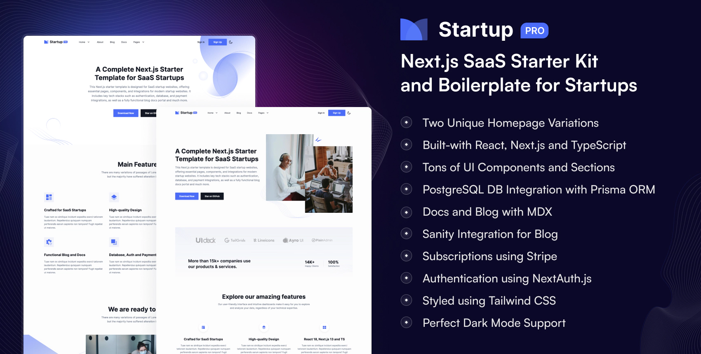

# Startup - Free Next.js Startup Website Template

Startup is a free, open-source, and premium-quality [**Next.js startup website template**](https://nextjstemplates.com/templates/startup) that comes with everything you need to launch a startup, business, or SaaS website, including all essential sections, components, and pages.

If you're looking for a high-quality and visually appealing, feature-rich Next.js Template for your next startup, SaaS, or business website, this is the perfect choice and starting point for you!

### ✨ Key Features

- Crafted for Startup and SaaS Business
- Next.js and Tailwind CSS
- All Essential Business Sections and Pages
- High-quality and Clean Design
- Dark and Light Version
- TypeScript Support
and Much More ...

### 🙌 Detailed comparison between the Free and Pro versions of Startup

| Feature             | Free | Pro |
|---------------------|------------|----------|
| Next.js Landing Page             | ✅ Yes      | ✅ Yes      |
| All The Integrations - Auth, DB, Payments, Blog and many more ...             | ❌ No      | ✅ Yes |
| Homepage Variations             | 1      | 2 |
| Additional SaaS Pages and Components             | ❌ No      | ✅ Yes |
| Functional Blog with Sanity       | ❌ No      | ✅ Yes |
| Use with Commercial Projects            | ✅ Yes      | ✅ Yes      |
| Lifetime Free Updates             | ✅ Yes      | ✅ Yes |
| Email Support       | ❌ No         | ✅ Yes       |
| Community Support         | ✅ Yes         | ✅ Yes       |

### [🔥 Get Startup Pro](https://nextjstemplates.com/templates/saas-starter-startup)

Startup Pro - Expertly crafted for fully-functional, high-performing SaaS startup websites. Comes with with Authentication, Database, Blog, and all the essential integrations necessary for SaaS business sites.

- [🚀 View Free Demo](https://startup.nextjstemplates.com/)

- [🚀 View Pro Demo](https://startup-pro.nextjstemplates.com/)

- [📦 Download](https://nextjstemplates.com/templates/startup)

- [🔥 Get Pro](https://nextjstemplates.com/templates/saas-starter-startup)

- [🔌 Documentation](https://nextjstemplates.com/docs)

### ⚡ Deploy Now

### 📄 License

Startup is 100% free and open-source, feel free to use with your personal and commercial projects.

### 💜 Support

If you like the template, please star this repository to inspire the team to create more stuff like this and reach more users like you!

### ✨ Explore and Download - Free [Next.js Templates](https://nextjstemplates.com)

### Update Log

**03 December 2025**

- Upgrade to Next.js 16
- Fixed video modal issue

**10 April 2025**

- Fix peer deps issue with Next.js 15
- Upgrade to tailwind v4
- Refactored blog cards for handling edge cases(text ellipsis on bio, keeping author details at the bottom etc.)
- Re-wrote blog details page with icons separation, fallback author image and better markup.
- Fixed duplicate key errors on homepage.
- Separated icons on theme-switcher button, and refactored scroll-to-top button.

**29 Jan 2025**

- Upgraded to Next.js 15
